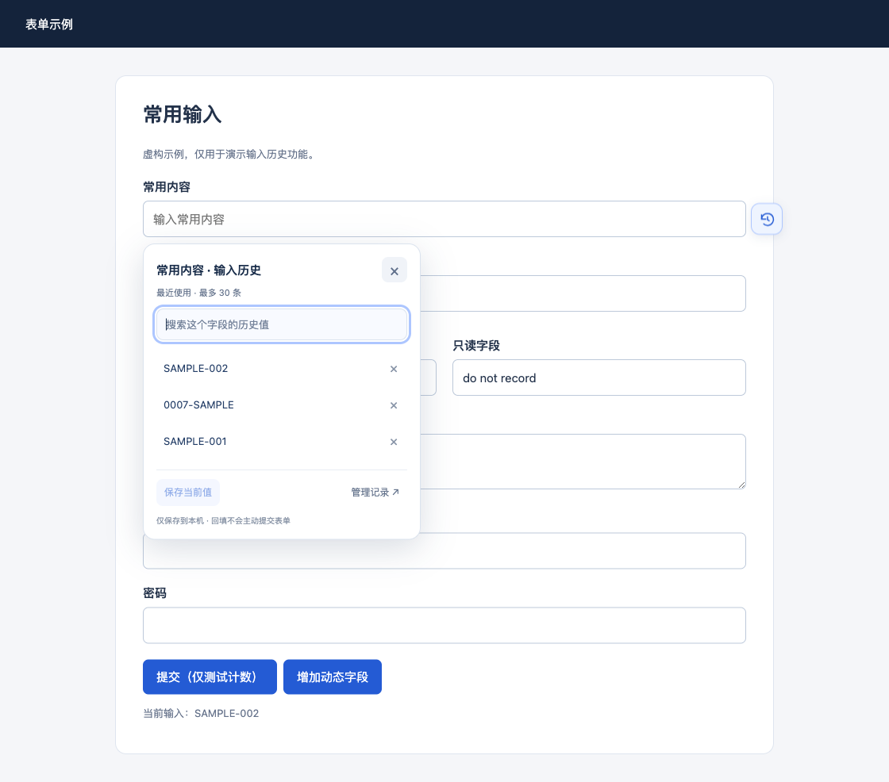

# 填记 · 输入历史

记住网页普通输入框中的常用内容。需要时，点击输入框旁的按钮，搜索并选择历史记录即可回填。数据仅保存在本机。

[下载最新版本](https://github.com/moran-extensions/tianji/releases/latest) · [问题反馈](https://github.com/moran-extensions/tianji/issues) · [隐私说明](PRIVACY.md) · [Moran Extensions](https://github.com/moran-extensions)

## 安装

目前通过 GitHub 下载后手动安装，无需商店账号。Chrome 已完成自动化场景检查；桌面版 Edge 可使用相同扩展目录，但尚未完成 Edge 实测。

1. 下载本仓库源码 ZIP 并解压，找到 `extension` 文件夹，无需安装 Node.js 或运行构建命令。若从 Releases 下载的是扩展安装包，则解压后直接使用含 `manifest.json` 的那一层文件夹。
2. Chrome 打开 `chrome://extensions`；Edge 打开 `edge://extensions`，开启 **开发者模式**。
3. 选择 **加载已解压的扩展程序**，选中上面的扩展文件夹。保留该文件夹，移动或删除可能影响插件加载。

## 使用

1. 打开需要使用的普通网页，点击工具栏上的“填记”扩展，选择 **启用本站记录**，按浏览器提示授予这个主机的访问权限。默认不在任何站点记录。
2. 在普通输入框中输入内容，输入完成离开该字段时保存。相同值会去重，每字段保留最近 30 条。
3. 下次聚焦输入框，旁边出现历史按钮。点击后搜索、选择历史值，直接回填当前字段。搜索框支持上下方向键、Enter 选择、Escape 关闭。
4. 可点击“保存当前值”主动记住页面现有值，或删除单条历史。在“管理历史记录”中可查看、搜索、删除字段/站点记录。



第一版专注文本、数字等标准 input（另支持普通 textarea）；不处理原生 select、富文本编辑器和复杂自定义下拉组件。历史按站点、端口、页面和字段区分，避免不同输入框混用记录，不保存页面查询参数。

## 更新与反馈

手动安装的版本不会通过应用商店自动更新。更新时下载新版本，将扩展文件替换到原来的文件夹，再在扩展管理页点击“重新加载”。保留原路径和扩展身份，不要先卸载；卸载会清除插件的本机数据。本机历史没有导出和备份功能。

Chrome 与 Edge 各自保存历史，不会跨浏览器同步。问题反馈可通过本仓库 Issues，说明浏览器版本、字段类型和复现步骤。截图与示例值请去除账号、内网地址、令牌等私人信息。验证范围见 [VALIDATION.md](VALIDATION.md)。

## 行为与边界

- 插件只填写你明确选择的当前字段，不批量填写、不主动提交表单。回填会触发 input/change，原网页可能运行原有校验或字段联动。
- 只自动记录经过真实键盘/输入操作的值；页面脚本设置的默认值不会自动记录。需要时可以在历史面板手动保存默认值。
- 跳过 password、hidden、只读/禁用字段，以及名称/标签等可识别的密码、验证码、Token、密钥等字段。这是防误记规则，无法识别所有伪装成普通字段的秘密。
- 历史以明文保存到当前浏览器资料的本机存储，不上传、不云同步。适用于非敏感参数，不是密码保险库。
- 暂停本站会保留历史并停止后续记录。主机授权还可在 Chrome 的扩展设置中撤销。Chrome 主机权限不细分端口，插件内部仍按完整来源地址隔离启用状态与记录。
- 每字段最多 30 条、最多 300 个字段、单值最多 2048 字符，总数据限制约 2 MiB；超出时淘汰最旧记录。
- 当前只处理顶层文档，不支持 iframe 和网页自身封闭 Shadow DOM 内的字段，不在无痕窗口运行。更换站点、任务路径或字段名称可能产生新的历史。

## 开发

```sh
npm ci
npm run build
npm run check
npm test
npm run package
```

构建使用 esbuild 将 `src/content.js` 和字段识别代码打包为 `extension/content.js`，无远程代码或运行时依赖。图标由代码绘制。当前扩展只需要 activeTab、scripting，站点访问作为可选权限按需申请，记录位于扩展自身来源的 IndexedDB，页面内容脚本不能直接读取整个记录库。

浏览器测试需 Puppeteer 和 Chrome for Testing，可安装 Puppeteer 后执行 `npm run test:browser`，也可通过 `PUPPETEER_MODULE` 指定现有模块入口、`CHROME_EXECUTABLE` 指定浏览器。测试使用临时配置与内存响应的虚构表单页，不访问或修改真实网站数据。

输出为 `dist/tianji-0.1.0.zip`（扩展 ZIP，manifest 位于根目录）和 `dist/tianji-source-0.1.0.zip`（源码）。当前通过 GitHub 分发，尚未提交应用商店。

动态按站点注入使用 Chrome 官方 [scripting API](https://developer.chrome.com/docs/extensions/reference/api/scripting) 与 [可选主机权限](https://developer.chrome.com/docs/extensions/develop/concepts/declare-permissions)。
